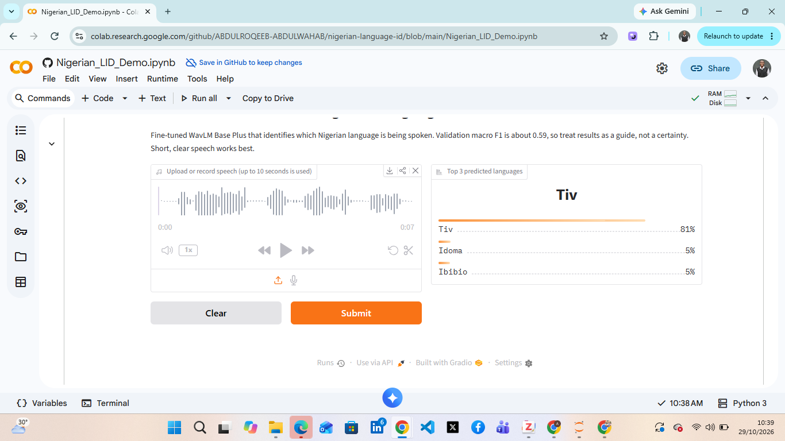

# Nigerian Language Identification

Speech language identification for **13 Nigerian language classes**, built with a fine-tuned **WavLM Base Plus** model at the **DSN AI Bootcamp 2026 hackathon** (Nigerian Language Identification Challenge).

Give it a short speech clip and it returns the top 3 most likely languages with confidence scores.

## Demo

Click the **Open Demo In Colab** badge above, choose *Runtime → Run all*, and open the `gradio.live` link printed by the last cell. Upload or record a short clip to try it. No GPU and no token are needed, because the model is public.

   

## Results

Evaluated on the held-out validation split (4,378 clips):

| Metric | Score |
|--------|-------|
| Macro F1 (raw) | **0.5907** |
| Macro F1 (after per-class bias calibration) | 0.6242 |
| Weighted F1 (raw) | 0.7568 |

The calibration offsets were tuned on the same validation set they are reported on, so the calibrated number is optimistic. The raw macro F1 is the more honest headline figure.

## Languages

Yoruba, Igbo, Hausa, Ego, Anaang, Efik, Ibibio, Idoma, Igala, Nupe, Tiv, Urhobo, and an "other" class.

## How it works

1. **Data:** `Data-Science-Nigeria/dsn-2026-lid-train` from Hugging Face, resampled to 16 kHz, clips cropped or padded to 10 seconds. Nupe had very few examples, so 26 of its training clips were moved into validation so every class is represented there.
2. **Model:** `microsoft/wavlm-base-plus` fine-tuned for audio classification (about 94.6M parameters).
3. **Imbalance handling:** dampened class weights.
4. **Augmentation:** pitch shift, noise, gain, and a low-pass filter to mimic phone audio and reduce speaker memorization.
5. **Training:** up to 4 epochs with FP16 and early stopping on macro F1.
6. **Calibration:** per-class bias offsets tuned on validation logits to raise macro F1, applied to the classifier bias in the saved weights.

## Repository contents

| File | Purpose |
|------|---------|
| `Nigerian_LID_Training.ipynb` | Training and export notebook (run on Colab with a T4 GPU) |
| `Nigerian_LID_Demo.ipynb` | Demo notebook that loads the published model and launches a Gradio app |
| `images/` | Demo screenshots |

## Run the training notebook

1. Create a Hugging Face account and a **write** access token.
2. In Colab, save the token as a secret named `HF_TOKEN` (🔑 tab) and turn on notebook access. **Never paste the token into the code.**
3. Use a T4 GPU runtime, mount Google Drive when prompted, and run the cells in order.
4. Set `REPO_ID` in the last cell to your own `username/model-name` before uploading.

## Limitations

- This is a **baseline**, not a production system. A macro F1 of about 0.59 means many clips are misclassified, and performance differs a lot between languages. For example, Yoruba is sometimes confused with Idoma.
- It was trained on one dataset, so recordings from phones, noisy rooms, or compressed apps may perform worse.
- Only the 13 listed classes are supported. Speech in any other language is forced into one of them or into "other".
- Very short clips (under about 2 seconds) are less reliable.

## Team

Built together, with equal contribution, at the DSN AI Bootcamp 2026 hackathon by:

- [Olawale Anthony Arowolo](https://www.linkedin.com/in/olawale-anthony-arowolo-5707b7292/)
- [Nnaluo Onyeka Collins](https://www.linkedin.com/in/nnaluo-onyeka-collins-4248a9370/)
- [Abdulwahab Abdulroqeeb Opeyemi](https://www.linkedin.com/in/abdulwahababdulroqeeb/)
- [Moshood Abdulganiyu](https://www.linkedin.com/in/moshood-abdulganiyu/)

Based on the team's original hackathon notebook. This version was retrained, packaged, and published by the team.

## Acknowledgements and licenses

- Base model: [microsoft/wavlm-base-plus](https://huggingface.co/microsoft/wavlm-base-plus).
- Dataset: [Data-Science-Nigeria/dsn-2026-lid-train](https://huggingface.co/datasets/Data-Science-Nigeria/dsn-2026-lid-train), whose audio has mixed per-source licenses. This repository does not redistribute any audio. See the dataset page for terms.
- Code license: MIT (add a `LICENSE` file when creating the repo).
